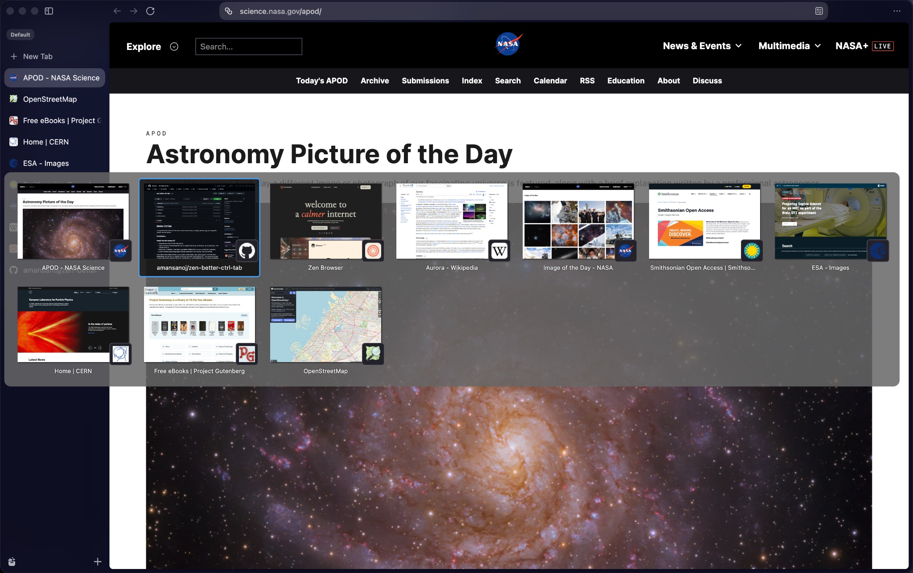
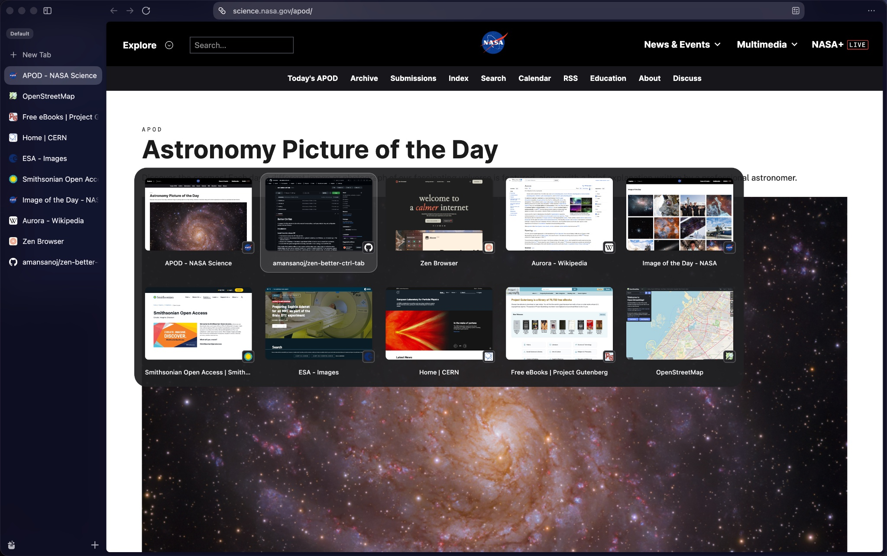

# Better CtrlTab

A compact CSS-only Ctrl+Tab switcher for Zen, with a neutral frosted surface,
a soft gray selection ring, and configurable preview rows and favicons.

## Index

- [Install](#install)
- [Settings](#settings)
- [Preview](#preview)
- [Troubleshooting](#troubleshooting)
- [Uninstall](#uninstall)
- [Source and credits](#source-and-credits)

## Install

1. [Download the ZIP](https://github.com/amansanoj/zen-better-ctrltab/archive/refs/heads/main.zip),
   extract it, and fully quit Zen.
2. In the extracted folder, run `python3 install.py` (Windows: `py -3 install.py`).
   Requires **Python 3.9+**, with no extra Python packages. Review the printed
   changes and confirm; use `--yes` for noninteractive installation.
3. Reopen Zen. In **Settings → Zen Mods**, toggle **Better CtrlTab** off and on
   once to rebuild the stylesheet.
4. Enable **Ctrl+Tab cycles through tabs in recently used order**, then hold
   **Ctrl+Tab** with several tabs open.

Requires Zen Mods and the native Ctrl+Tab switcher. Untested on a live Zen
build for compact mode, tab orientations, and accessibility settings.

For an explicit profile (recommended with multiple installations):

```sh
python3 install.py --list-profiles
python3 install.py --profile "/path/from/about:support" --dry-run
python3 install.py --profile "/path/from/about:support"
```

The installer reads `profiles.ini` / `installs.ini`, including install defaults
and relative or absolute profile paths. It also searches conventional macOS,
Windows, Linux, Flatpak and Snap locations. Ambiguous defaults require
`--profile`. Custom locations can always be selected using the **Profile Folder**
shown in `about:support`.

Existing files that change are copied into timestamped
`<profile>/.better-ctrltab-backups/` directories before writes. Unchanged files
are left alone; reinstall preserves the mod's enabled state. Quit Zen before
applying changes. `--yes` never overrides profile lock checks.

## Settings

Open **Settings → Zen Mods**, then the gear on **Better CtrlTab**.

| Setting | Options | Default |
| --- | --- | --- |
| Favicon position | Overlap left, center, right; before or after title; hide | Overlap right |
| Previews per row | 1–7 | 5 |

Rows are capped at the selected column count; narrow windows can use fewer
columns. The final row is centered.

To change the **total** number of previews, search for
`browser.ctrlTab.maxPreviews` in `about:config`. If your build exposes it, you
can change it yourself; otherwise the build controls the total. For example,
nine eligible previews with five columns can form rows of five and four.
**Neither the mod nor the installer writes this preference.**

## Preview

| Before | After |
| --- | --- |
|  |  |

These are the existing screenshots, not verification of this revision. Zen
controls the popup's screen position. The default frosted surface is translucent;
it does not sample or blur the web page behind it.

## Troubleshooting

- **Mod missing:** confirm that `--profile` points to the active Profile Folder
  from `about:support`, then reopen Zen and inspect Settings → Zen Mods.
- **Settings have no effect:** keep the display name **Better CtrlTab**; its name
  determines the hidden settings marker. Toggle the mod off/on to rebuild CSS.
- **Duplicate styles:** remove the old manual import of this mod from
  `userChrome.css`, then restart Zen. The installer does not edit that file.
- **Multiple profiles:** use `--list-profiles`, then select the active folder
  explicitly. Different installations can have different defaults.
- **Profile locked:** fully quit Zen, including background processes. Persistent
  unlocked lock files are accepted automatically; do not delete them. Active
  locks, unreadable locks, and ambiguous legacy symlink locks are refused.
  A dry run is allowed while locked and writes nothing.
- **Installer fails:** invalid registries and conflicting mod IDs are refused.
  Check the printed error and backups. Writes are atomic per file, not across
  the whole operation; after an interrupted operation, quit Zen and restore
  affected files from the printed backup directory or rerun the installer.
- **Popup changed after an update:** native IDs/classes are internal browser
  interfaces. Report the exact Zen version, OS, theme, tab orientation and
  compact-mode state.

## Uninstall

Quit Zen, then run:

```sh
python3 install.py --profile "/path/to/profile" --uninstall --dry-run
python3 install.py --profile "/path/to/profile" --uninstall
```

This backs up and removes this mod's registry entry and three bundled files.
Unrelated mods and unknown files in its folder are preserved; the mod folder is
removed only if empty. Backups remain for manual recovery. Alternatively use
**Remove mod** on its Zen Mods card (Zen handles that removal). Remove any old
manual CSS import separately.

## Source and credits

Based on [Better CtrlTab Panel](https://github.com/psu/zen-mods/tree/main/better-ctrl-tab)
by **Pontus Sundén**.

Derived from Better CtrlTab Panel; the upstream repository does not currently state a license.

`chrome.css` styles the switcher; `preferences.json` defines the two dropdowns.
The installer registers the bundled files directly with Zen Mods using a stable
UUID. There is no JavaScript loader or runtime dependency. Tweak variables,
development checks and screenshot guidance are in [CONTRIBUTING.md](CONTRIBUTING.md).
