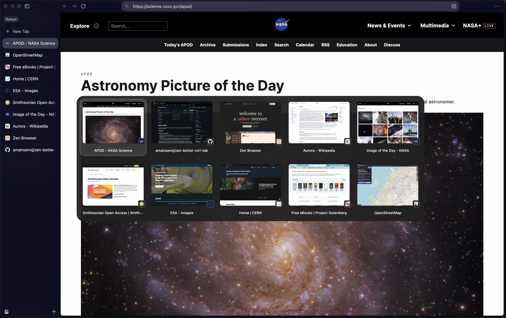

# Better CtrlTab



A compact Ctrl+Tab switcher for Zen with a neutral frosted surface, a soft gray selection ring, and configurable preview rows and favicons.

## Installation

### Install from the release ZIP

1. Download and extract the ZIP. Fully quit Zen.
2. Open a terminal in the extracted folder and run `python3 install.py` (on Windows, `py -3 install.py`). This requires Python 3.
3. Reopen Zen. In **Settings → Zen Mods**, toggle **Better CtrlTab** off and on once to rebuild Zen's stylesheet.
4. Enable **Ctrl+Tab cycles through tabs in recently used order** in Zen's settings, then hold **Ctrl+Tab**.

If the installer finds multiple profiles or uses a custom profile location, open `about:support` to find the active **Profile Folder**, quit Zen, and run `python3 install.py --profile "/path/to/profile"`. If you previously installed a manual CSS preview, remove its import from `userChrome.css` to avoid duplicate rules. To uninstall, use **Remove mod** on the Better CtrlTab card.

### Preview the CSS locally before publication

1. Extract the ZIP. In Zen, open `about:support` and open the **Profile Folder**.
2. Create a `chrome` folder inside the profile if needed. Copy the extracted `chrome.css` there as `better-ctrltab.css`.
3. Create or open `userChrome.css` in that folder. Add this import before any style rules.

   ```css
   @import url("better-ctrltab.css");
   ```

4. In `about:config`, set `toolkit.legacyUserProfileCustomizations.stylesheets` to `true`. Fully quit and reopen Zen.
5. Enable recently used tab cycling in Zen's settings, then hold **Ctrl+Tab**.

The manual CSS preview uses the default styles. The dropdowns require a Zen Mods installation that loads `preferences.json`. Remove the manual import before switching to the ZIP installer so the mod toggle controls the styling.

## Zen Mods settings

Open **Settings → Zen Mods**, then click the gear on **Better CtrlTab**.

| Setting | Options | Default |
| --- | --- | --- |
| Favicon position | Overlap left, center, or right. Before or after the title. Hide favicon. | Overlap right |
| Previews per row | 1–7 | 5 |

**Previews per row** caps the number of columns. Narrow layouts can use fewer columns.

To change the **total number of previews**, open `about:config` and search for `browser.ctrlTab.maxPreviews`. If your Zen build exposes it, set it to the total you want. For example, set it to **9** and keep **Previews per row** at **5** to get **5 + 4** in a wide enough window with nine eligible tabs. If the preference is absent, your build controls the total. The mod never writes this preference.

## Source package

`chrome.css` styles the switcher and `preferences.json` defines the two Zen Mods dropdowns. Use **Better CtrlTab** as the display name so the stylesheet can find the settings marker Zen creates. The ZIP contains the source files for the `zen-better-ctrltab` repository. The included installer registers the bundled files directly with Zen Mods.

Zen controls the native popup's screen position. The frosted appearance is a translucent surface and does not sample or blur the page behind it. The CSS-only package requires no JavaScript loader.

Zen displays this description below the mod name.

> Customize Ctrl+Tab. Set the total in about:config via browser.ctrlTab.maxPreviews.

## Credits

Based on [Better CtrlTab Panel](https://github.com/psu/zen-mods/tree/main/better-ctrl-tab) by Pontus Sundén.
